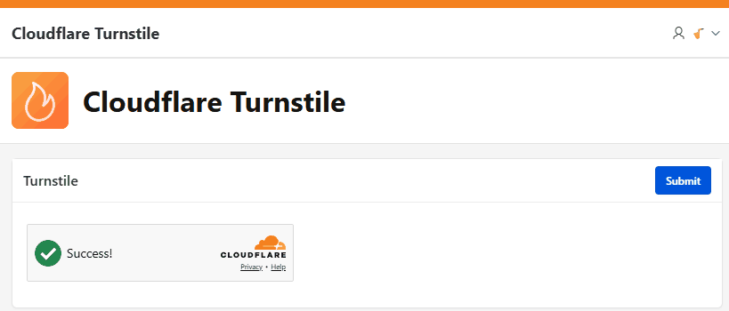

# Pretius Cloudflare Turnstile

An Oracle APEX item plug-in that adds a [Cloudflare Turnstile](https://developers.cloudflare.com/turnstile/) challenge to a page and verifies the token on the server when the page is submitted. Turnstile is a privacy-friendly CAPTCHA alternative: most visitors never see a puzzle.

## Preview

[](assets/preview.gif)

## Demo

Try it live: [oracleapex.com/ords/r/luf/cloudflare-turnstile](https://oracleapex.com/ords/r/luf/cloudflare-turnstile)

## Features

- Server-side verification through the Cloudflare `siteverify` API, run as a native APEX item validation
- Fails closed: a missing, expired, reused or rejected token, or a network error, raises a validation error
- Site and secret keys set once per application in **Component Settings**, with `&ITEM.` substitution support so keys can stay out of exports
- Theme (auto / light / dark), size (flexible / normal / compact) and appearance (always / execute / interaction only)
- Optional **Action**, which tags the widget in Cloudflare analytics and is checked on the server to stop token replay between forms
- Client-side validation: a submit with validation is blocked until the challenge is solved
- Automatic new challenge after each submit, so a page that fails another validation can be submitted again
- Several Turnstile items per page, and the Cloudflare script is loaded only once
- Builder help text on the plug-in and every attribute
- Debug logging through `apex_debug` (server) and `apex.debug` (browser)

## Installation

### 1. Import the plug-in

1. Go to **Shared Components** > **Plug-ins**
2. Click **Import**
3. Upload `item_type_plugin_com_pretius_apex_turnstile.sql`
4. Follow the import wizard

### 2. Allow the database to call Cloudflare

The validation calls `https://challenges.cloudflare.com/turnstile/v0/siteverify` from the database. You need:

- **A network ACL** for the APEX schema. Run it as a DBA, and replace `APEX_260100` with your APEX schema (`select schema from dba_registry where comp_id = 'APEX'`):

    ```sql
    begin
        dbms_network_acl_admin.append_host_ace(
            host       => 'challenges.cloudflare.com',
            lower_port => 443,
            upper_port => 443,
            ace        => xs$ace_type(
                              privilege_list => xs$name_list( 'http' ),
                              principal_name => 'APEX_260100',
                              principal_type => xs_acl.ptype_db ) );
    end;
    /
    ```

- **A wallet that trusts the Cloudflare certificate**, set in *Instance Administration > Instance Settings > Wallet*. On Autonomous Database and recent DB versions with the system certificate store this is already in place.

### 3. Create a Turnstile widget

In the Cloudflare dashboard, go to **Turnstile** > **Add widget**, add the host name of your APEX instance, and copy the **Site Key** and **Secret Key**.

### 4. Enter the keys

Go to **Shared Components** > **Component Settings** > **Pretius Cloudflare Turnstile**:

| Setting | Description |
|---------|-------------|
| **Site Key** | Public key, sent to the browser |
| **Secret Key** | Private key, only used on the server |
| **Enabled** | Turns Turnstile on or off for the whole application |

### 5. Add the item

Add a page item of type **Pretius Cloudflare Turnstile** to the form you want to protect. Make sure the submit button has **Execute Validations** set to **Yes**.

| Attribute | Default | Description |
|-----------|---------|-------------|
| **Theme** | Auto | `auto`, `light` or `dark` |
| **Size** | Flexible | `flexible` (container width), `normal` (300 x 65px), `compact` (150 x 140px) |
| **Appearance** | Always | `always`, `execute` (only while running) or `interaction-only` |
| **Action** | | Optional label, up to 32 characters (`a-z A-Z 0-9 - _`). Checked on the server when set |
| **Error Message** | Please complete the security check. | Shown when the check is missing or fails. Translatable |

## Keeping the secret key out of exports

Component Settings are part of the application definition, so a key typed in directly is included in every application export and APEXlang file. To keep it out:

1. Create an application item `TURNSTILE_SECRET_KEY` with **Session State Protection** set to **Restricted - May not be set from browser**.
2. Create an application process (**On New Instance**) that reads the key from a secured table or vault, for example:

    ```sql
    :TURNSTILE_SECRET_KEY := my_config_pkg.get_value( 'TURNSTILE_SECRET_KEY' );
    ```

3. Set the **Secret Key** component setting to `&TURNSTILE_SECRET_KEY.`

The same approach works for the **Site Key**, so each environment can use its own Cloudflare widget.

## Testing

Cloudflare provides [dummy keys](https://developers.cloudflare.com/turnstile/troubleshooting/testing/) for development and automated tests:

| Site Key | Behavior |
|----------|----------|
| `1x00000000000000000000AA` | Always passes (visible) |
| `2x00000000000000000000AB` | Always blocks (visible) |
| `3x00000000000000000000FF` | Forces an interactive challenge (visible) |

| Secret Key | Behavior |
|------------|----------|
| `1x0000000000000000000000000000000AA` | Always passes |
| `2x0000000000000000000000000000000AA` | Always fails |
| `3x0000000000000000000000000000000AA` | Yields a "token already spent" error |

Use test keys in development instead of turning **Enabled** off, so the whole flow keeps running.

## Content Security Policy

If your application sends a Content Security Policy, allow Cloudflare in both directives:

```
script-src https://challenges.cloudflare.com;
frame-src  https://challenges.cloudflare.com;
```

## JavaScript API

The plug-in exposes `window.pretiusCloudflareTurnstile`:

| Method | Description |
|--------|-------------|
| `reset(itemName)` | Clears the token and starts a new challenge |
| `getResponse(itemName)` | Returns the current token, or `""` |
| `hasLoadError()` | `true` if the Cloudflare script could not be loaded |
| `getVersion()` | Plug-in version |

```javascript
pretiusCloudflareTurnstile.reset("P2_CHECK");
```

## Debugging

- **Server:** run the page in debug mode and look for `Turnstile:` entries in the debug log. Failed checks log the Cloudflare response, including `error-codes`.
- **Browser:** run the page in debug mode (or `apex.debug.setLevel(4)`) and look for `Pretius Cloudflare Turnstile:` in the console.

Common `error-codes`:

| Code | Meaning |
|------|---------|
| `invalid-input-secret` | Wrong secret key |
| `invalid-input-response` | Token is malformed or was issued for another site key |
| `timeout-or-duplicate` | Token expired (after 300 seconds) or was already verified |

## Important information

- The check runs as an item validation. A submit that skips validations (for example, a button with **Execute Validations** set to **No**) skips the check too.
- A **Read Only** or **Server-side Condition** that hides the item also removes the widget. Do not make the item read-only on pages you need to protect.
- Each token can only be verified once. The plug-in starts a new challenge after every submit.

## Compatibility

- Oracle APEX: `26.1.x`
- Plug-in version: `26.1.0`
- Oracle DB: all versions supported by Oracle APEX `26.1.x`

## License

MIT (see `LICENSE`)
